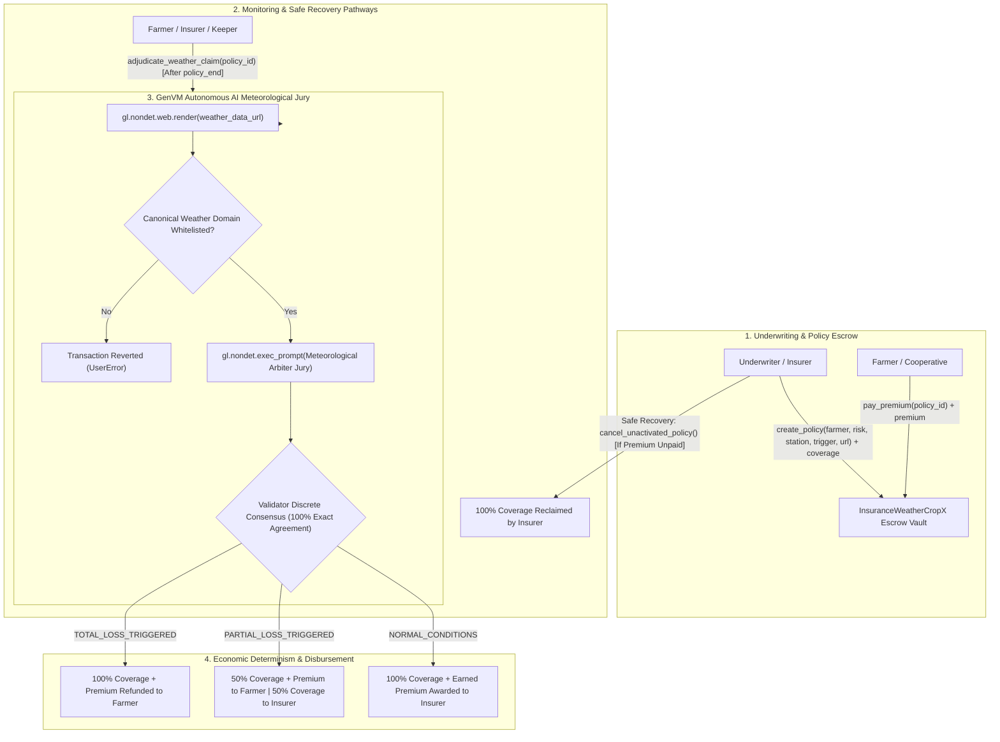

# InsuranceWeatherCropX — Parametric Extreme Weather Drought & Flood Insurance Protocol

> **Track:** Prediction Markets & Real-World Settlement  
> **Network:** GenLayer studionet (Chain ID: `61999` / `0xF1EF`)  
> **Target Environment:** [GenLayer Studio](https://studio.genlayer.com)  
> **Execution Engine:** GenVM / Optimistic Democracy Semantic Consensus  
> **Contract Source:** [`contracts/insurance_weather_crop_x.py`](contracts/insurance_weather_crop_x.py)  

---

## 1. Live Deployment & Verification

The **InsuranceWeatherCropX** Intelligent Contract is deployed, finalized, and verified on GenLayer **studionet**:

- **CONTRACT_ADDRESS:** `0x7315b8c5F0DC2f1edD893a19e620376dB0a43140`
- **TRANSACTION_HASH:** `0x8784664307bf7189569923104386b1d5d8ee1ff09205605853752e4e201bb92b`
- **DEPLOYER_ADDRESS:** `0xDffe31488277e8cAF6F241766012F71608Af1557`
- **NETWORK:** `studionet` (Chain ID: `61999` / `0xF1EF`)
- **RPC_URL:** `https://studio.genlayer.com/api`
- **RECEIPT_STATUS:** `5` (FINALIZED)
- **RESULT:** `6` (SUCCESS)
- **Deployment Details:** [`deployment.json`](deployment.json)

---

## 2. Core Problem & The 1-Line Pitch

### The Core Problem
Smallholder farmers and agricultural cooperatives worldwide face catastrophic financial ruin from extreme climate events, notably multi-week severe droughts and torrential floods. Traditional agricultural insurance suffers from severe friction:
1. **Prolonged Field Audits:** Traditional claims processing takes 3 to 6 months while loss adjusters travel to rural areas to inspect damaged crops.
2. **Administrative Overhead & Disputes:** Bureaucratic overhead consumes up to 30–40% of insurance premiums, leading to contentious disputes over subjective crop damage assessments.
3. **Legacy Blockchain Limitations:** Standard smart contracts (e.g. on Ethereum or Solana) cannot directly scrape meteorological portals, cannot interpret complex multi-day observation streams (cumulative rainfall, consecutive dry days, soil moisture), and cannot evaluate nuanced parametric disaster triggers without relying on vulnerable centralized Web2 oracles.

### Why This Primitive DIES Without GenLayer (The 1-Line Pitch)
> *"Legacy blockchains cannot scrape official meteorological observation APIs or interpret multi-week precipitation reports directly on-chain; without GenLayer's non-deterministic web rendering (`gl.nondet.web.render`) and LLM validator jury consensus (`gl.vm.run_nondet`), an autonomous, zero-human-intervention parametric weather insurance protocol is fundamentally impossible."*

---

## 3. Architecture & System Flow



---

## 4. Economic Determinism & Discrete Consensus Mechanics

### 1. 100% Discrete Consensus Binding
LLM nondeterminism usually breaks traditional blockchain consensus because validators querying an LLM produce slight phrasing variances in their reasoning texts. **InsuranceWeatherCropX** eliminates consensus divergence by enforcing **discrete semantic categorization**:

```python
def validator_fn(leader_res) -> bool:
    if not isinstance(leader_res, gl.vm.Return):
        return False
    leader = leader_res.calldata
    ...
    mine = leader_fn()
    # DISCRETE EQUIVALENCE: 100% agreement on exact disaster verdict
    return leader["verdict"] == mine["verdict"]
```

| Classification Verdict | Adjudication Condition | Financial Disbursement |
|---|---|---|
| `TOTAL_LOSS_TRIGGERED` | Meteorological records prove extreme catastrophic disaster conditions meeting or exceeding trigger threshold (e.g., continuous 0mm rain > 30 days, or rainfall > 400mm in 48h). | **100% Coverage + Premium Refunded to Farmer** (`policy.coverage_amount + policy.premium_paid`), **0 GEN to Insurer** |
| `PARTIAL_LOSS_TRIGGERED` | Severe weather occurred near or touching the threshold, causing substantial localized crop yield reduction. | **50% Coverage + Premium to Farmer**, **50% Coverage Returned to Insurer** |
| `NORMAL_CONDITIONS` | Meteorological parameters stayed within normal seasonal variance; threshold was not breached, or endpoint returned 404/offline. | **0 GEN to Farmer**, **100% Coverage + Earned Premium to Insurer** |

### 2. Canonical Weather Domain Whitelist
To prevent malicious actors from providing fraudulent weather endpoints or spoofing precipitation data, the contract enforces a strict host whitelist:
- `open-meteo.com`
- `archive-api.open-meteo.com`
- `api.open-meteo.com`
- `weather.gov`
- `api.weather.gov`
- `noaa.gov`
- `www.noaa.gov`
- `ecmwf.int`
- `mock-weather.genlayer.com`
- The contract owner can dynamically authorize new governmental meteorological agencies via `add_allowed_weather_domain()` or revoke domains via `remove_allowed_weather_domain()`.

---

## 5. Contract Interface

### Public Write Methods

- **`create_policy(farmer: Address, risk_type: str, station_id: str, trigger_threshold: str, weather_data_url: str, policy_duration_sec: int) -> str`** `[PAYABLE]`  
  Insurer/Underwriter funds total coverage into escrow, binds target farmer, risk type (`DROUGHT` or `FLOOD`), weather station ID, trigger description, and meteorological URL. Returns unique `policy_id`.
  
- **`pay_premium(policy_id: str) -> None`** `[PAYABLE]`  
  Designated farmer pays their required insurance premium deposit to activate coverage monitoring.
  
- **`adjudicate_weather_claim(policy_id: str) -> None`**  
  Callable once `policy_end` timestamp is reached. Initiates GenLayer validator web scraping of official weather data, invokes the autonomous LLM jury, reaches discrete consensus, and disburses payouts immediately.

- **`cancel_unactivated_policy(policy_id: str) -> None`**  
  Safe insurer recovery path: If a farmer fails to deposit premium, the underwriter can cancel the unactivated policy and reclaim 100% of their locked coverage.

- **`add_allowed_weather_domain(domain: str) -> None`**  
  Owner-only method to whitelist new meteorological data providers.

- **`remove_allowed_weather_domain(domain: str) -> None`**  
  Owner-only method to revoke deprecated or compromised observation domains.

### Public View Methods

- **`get_policy(policy_id: str) -> str`**  
  Returns full JSON representation of policy parameters, status, verdict, timestamps, and settlement amounts.
  
- **`is_weather_domain_allowed(domain: str) -> bool`**  
  Checks if a given domain is currently in the active whitelist.
  
- **`get_policy_count() -> int`**  
  Returns total count of issued insurance policies.
  
- **`get_owner() -> str`**  
  Returns owner address in lowercase hex.

- **`get_current_time() -> int`**  
  Returns deterministic timestamp derived from GenLayer execution context.

---

## 6. Edge Cases & Resilience Engineering

| Potential Vulnerability / Failure Mode | Defense Mechanism | GenLayer Implementation |
|---|---|---|
| **Underwriter funds locked in ghost policy** | Safe Recovery Cancellation | `cancel_unactivated_policy()` allows underwriter to retrieve 100% of coverage funds if farmer never deposits premium. |
| **Premature settlement before season ends** | Timestamp Guard | `adjudicate_weather_claim()` strictly verifies `now_ts >= policy.policy_end`. |
| **Unactivated policy exploit** | Premium Activation Check | Rejects adjudication if `premium_paid == 0`, preventing free coverage exploitation. |
| **Phishing / Fake Weather API URLs** | Domain Whitelist & Host Parsing | `_parse_url_host()` strips paths/parameters and enforces canonical whitelist checking. |
| **Meteorological API 404 or Offline** | Graceful Degradation | If the weather endpoint is blank, offline, or returns 404, the arbiter defaults to `NORMAL_CONDITIONS` to ensure capital is never permanently trapped. |
| **Malformed LLM Outputs** | Resilient JSON Stripping | `_parse_llm_json()` defensively handles markdown code fences (` ```json `), trailing brackets, and schema mismatches. |
| **Native Token Transfer Safety** | SDK Transfer Standard | Uses `gl.get_contract_at(recipient).emit_transfer(value=u256(amount))` to safely disburse native GEN without relying on nonexistent `gl.eth` APIs. |

---

## 7. Testing & Verification

The test suite runs with `gltest` against GenVM simulation fixtures:

```bash
# Run full unit and consensus test suite
pytest tests
```

### Test Coverage Highlights:
- ✅ `test_initial_state_and_domains`: Initial parameters, whitelists, owner controls.
- ✅ `test_create_policy_success`: Underwriter escrow creation for DROUGHT & FLOOD policies.
- ✅ `test_create_policy_validations`: Zero coverage, self-insurance prevention, invalid risk types, invalid URLs.
- ✅ `test_pay_premium_success`: Farmer premium deposit and status progression.
- ✅ `test_pay_premium_validations`: Non-farmer caller rejection, zero premium rejection.
- ✅ `test_cancel_unactivated_policy_success`: Insurer safe recovery before activation.
- ✅ `test_cancel_unactivated_policy_validations`: Cancellation blocked after premium payment.
- ✅ `test_adjudicate_validation_failures`: Rejection of premature or unactivated claims.
- ✅ `test_adjudicate_total_loss_triggered`: Autonomous 100% indemnity payout to farmer upon extreme drought/flood.
- ✅ `test_adjudicate_partial_loss_triggered`: 50/50 indemnity split for moderate extreme events.
- ✅ `test_adjudicate_normal_conditions`: Insurer earns premium and reclaims coverage when weather is safe.
- ✅ `test_adjudicate_offline_or_404_fallback`: Safe fallback when observation endpoint is unreachable.

---

## 8. Deployment Guide

### Deploy to GenLayer Studionet

```bash
# Install dependencies
pip install -r requirements-dev.txt

# Run automated deployment script
python scripts/deploy_studionet.py
```

The script will:
1. Connect to GenLayer Studionet RPC (`https://studio.genlayer.com/api`).
2. Generate or load a deployer account and request faucet tokens.
3. Deploy `contracts/insurance_weather_crop_x.py`.
4. Wait for transaction finality and export verified details to `deployment.json`.

---

## 9. License

MIT License. Built for the **GenLayer Builder Program** (Track: *Prediction Markets & Real-World Settlement*).
